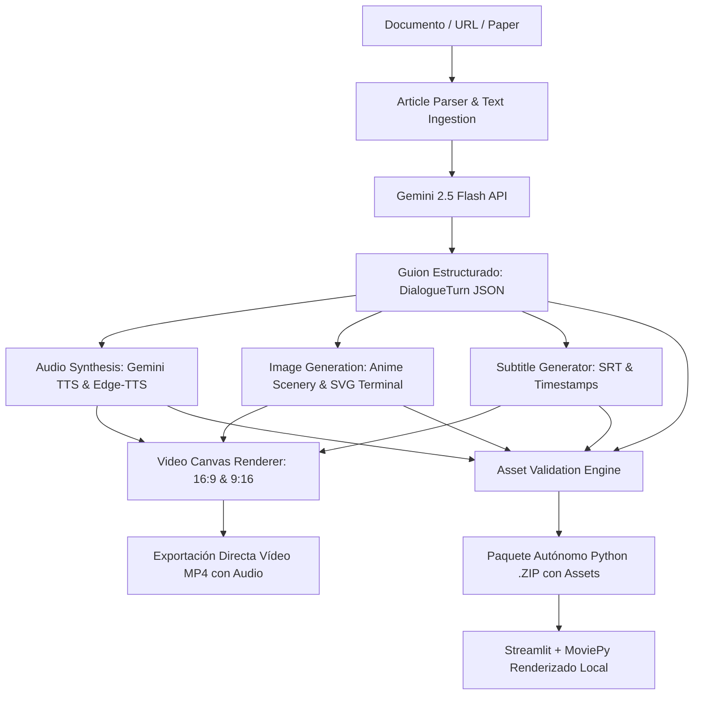

# 🎙️ NotebookLM Studio to YouTube Video Generator
### Un Fantasma en el Sistema ([www.unfantasmaenelsistema.com](https://www.unfantasmaenelsistema.com/))

[](https://www.typescriptlang.org/)
[](https://react.dev/)
[](https://tailwindcss.com/)
[](https://www.python.org/)
[](https://streamlit.io/)
[](https://github.com/rany2/edge-tts)
[](https://zulko.github.io/moviepy/)
[](https://ai.google.dev/)
[](https://opensource.org/licenses/MIT)

> **Generador integral, modular y profesional para transformar artículos, papers y documentos técnicos en podcasts de vídeo listos para YouTube y YouTube Shorts**, con diálogo espontáneo entre dos locutores al estilo *NotebookLM Audio Overview*, síntesis neuronal ultra HD, avatares reactivos, fondos anime consistentes en lote, terminal interactiva con coloreado de sintaxis, tablas autoadaptables, post-intro cinemática y exportación autónoma tanto en vídeo MP4 directo como en paquete ejecutable local de Python auditado al 100%.

---

## 📸 Capturas Visuales y Demostración de Interfaz

### 1. 🎛️ Estudio de Vídeo y Línea de Tiempo Interactiva
```text
+----------------------------------------------------------------------------------------------------+
|  🎙️ NotebookLM Studio | Un Fantasma en el Sistema [unfantasmaenelsistema.com]       ⚙️ API Key  [●] |
+----------------------------------------------------------------------------------------------------+
| [1. Ingesta & Locutores]  [2. Guion Estructurado]  [3. Síntesis & Audio]  [4. Vídeo Final (16:9)]  |
+----------------------------------------------------------------------------------------------------+
|  PREVISUALIZADOR EN VIVO (CANVAS 1280x720)                       CONFIGURACIÓN DE BRANDING         |
|  +-------------------------------------------------------------+ +-------------------------------+ |
|  | [Redes inalámbricas | unfantasmaenelsistema.com] [LOGO]     | | 🎨 Estilo Visual: [Anime ▼]   | |
|  |                                                             | | ⚡ Generar Fondos Anime Lote  | |
|  |     "¿Cómo la IA Agéntica ha revolucionado el hardware?"   | |    [Shinkai] [Cyberpunk]      | |
|  |                                                             | |                               | |
|  |  +---------------------------+ +--------------------------+ | | 🎬 Portada Inicial (Intro)    | |
|  |  | 👤 Alex (Host A) [Habla]  | | 👤 Sam (Host B) [Escucha]| | | ⚡ Post-Intro Cinemática      | |
|  |  |    Ondas de Voz: |||||||  | |    Avatar Reactivo: ( - )| | |    [Optical Flare & Laser ▼]  | |
|  |  +---------------------------+ +--------------------------+ | | 🏁 Pantalla Final (Outro CTA) | |
|  |  [Alex]: "Ya no existe retardo de transcripción, Sam..."    | |                               | |
|  +-------------------------------------------------------------+ | 📦 Exportar Paquete Python    | |
|  [▶ Reproducir]  [00:14 / 01:28] ▬▬▬▬▬▬▬▬▬●▬▬▬▬▬▬▬▬▬ [Vol 100%]  | | 🎬 Compilar Vídeo MP4         | |
+------------------------------------------------------------------+-------------------------------+ |
```

### 2. 🎬 Post-Intro Cinemática con Anamorphic Optical Flare y Haz Láser
```text
+----------------------------------------------------------------------------------------------------+
|                           *       .          *              .               *                      |
|       .               *                 .              *            .                 *            |
|                                                                                                    |
|    ┌──                                                                                      ──┐    |
|       REDES INALÁMBRICAS | UNFANTASMAENELSISTEMA.COM                                              |
|                                                                                                    |
|    ═══════════════════════════════[ ANAMORPHIC OPTICAL FLARE ]════════════════════════════════    |
|                                                                                                    |
|            LA REVOLUCIÓN DE LA INTELIGENCIA ARTIFICIAL AGÉNTICA EN 2026                            |
|             escuchar sin transmitir, y ver mucho más que solo WiFi                                |
|                                                                                                    |
|    └──                                                                                      ──┘    |
|       [ AUDIO SYNTHESIZED SPECTRUM ]  |||||||||||||||||||||||||||||||||||||                        |
+----------------------------------------------------------------------------------------------------+
```

### 3. 💻 Ventana Terminal Enriquecida con Coloreado de Sintaxis
```text
+----------------------------------------------------------------------------------------------------+
|  +----------------------------------------------------------------------------------------------+  |
|  | ● ● ●  user@unfantasma: ~/auditoria_redes                                  [BASH 5.2] [SYS] |  |
|  +----------------------------------------------------------------------------------------------+  |
|  |                                                                                              |  |
|  |  $ airmon-ng start wlan0 --verbose                                                           |  |
|  |    [OK] Interface wlan0 set into monitor mode (mon0)                                         |  |
|  |                                                                                              |  |
|  |  $ kismet -c mon0 --use-gpsd --filter-tracker "bssid=XX:XX:XX"                               |  |
|  |    [*] Initializing wireless passive capture pipeline...                                     |  |
|  |    [!] Warning: High channel congestion detected in 5.8 GHz band                             |  |
|  |    [+] Packets captured: 142,850 | Handshakes captured: 4                                    |  |
|  |                                                                                              |  |
|  |  $ tshark -r capture.pcap -Y "wlan.fc.type_subtype == 0x08" -T fields -e wlan.ssid █         |  |
|  |                                                                                              |  |
+----------------------------------------------------------------------------------------------------+
```

### 4. 📊 Tablas Autoadaptables con Detección de Badges de Protocolo
```text
+----------------------------------------------------------------------------------------------------+
|  MATRIZ COMPARATIVA DE PROTOCOLOS DE SEGURIDAD Y TELEMETRÍA (2026)                                  |
|  +-------------------+----------------------+--------------------+-------------------------------+  |
|  | PROTOCOLO         | CIFRADO / INTEGRIDAD | CONSUMO ESPECTRAL  | ESTADO DE SEGURIDAD           |  |
|  +-------------------+----------------------+--------------------+-------------------------------+  |
|  | WPA3-Enterprise   | AES-GCM-256 (CNSA)   | Bajo (OFDMA)       | [✓ SEGURO] Robusto / PMF      |  |
|  | WPA2-Personal     | CCMP / TKIP          | Medio (Legacy)     | [!] VULNERABLE a Deauth       |  |
|  | OWE (Enhanced)    | Diffie-Hellman 19    | Óptimo (Open WiFi) | [✓ PROTEGIDO] Sin Passphrase  |  |
|  | BLE Mesh 2.0      | Two-Level AES-128    | Ultrabajo (IoT)    | [✓ SEGURO] Replay-Protected   |  |
|  +-------------------+----------------------+--------------------+-------------------------------+  |
+----------------------------------------------------------------------------------------------------+
```

### 5. 🛡️ Consola de Auditoría y Validación de Assets del Paquete Python
```text
+----------------------------------------------------------------------------------------------------+
| [10:28:15] [PASS] SCRIPT   Guion final validado: "El Salto Agéntico 2026" (7 turnos, 480 palabras) |
| [10:28:16] [PASS] AUDIO    Pista Turno 1 [Host_A]: turn_0_Host_A.wav (182 KB, voz Puck HD)         |
| [10:28:17] [PASS] AUDIO    Pista Turno 2 [Host_B]: turn_1_Host_B.wav (145 KB, voz Kore HD)         |
| [10:28:18] [PASS] IMAGES   Fondo anime Turno 1: turn_0.svg generado (Makoto Shinkai Twilight)     |
| [10:28:19] [PASS] IMAGES   Fondo terminal Turno 2: turn_1.svg generado (Cyberpunk HUD Grid)         |
| [10:28:20] [PASS] SCRIPT   Subtítulos .SRT sincronizados generados con timestamps precisos         |
| [10:28:21] [PASS] CODE     Módulos Python autónomos validados (app.py, video_engine.py, MoviePy)   |
| [10:28:22] [PASS] PACKAGE  Watermark de logo integrado: icono.png (67 KB)                          |
| [10:28:23] [PASS] PACKAGE  ✨ Paquete validado al 100%: 7 audios, 7 fondos, script.json (1.82 MB)  |
+----------------------------------------------------------------------------------------------------+
```

---

## 🚀 Las 4 Nuevas Mejoras Integradas

1. **Integración Directa de las Voces de los Locutores en el Vídeo Exportado (`.mp4`)**:
   - Compilación con Web Audio API mediante un nodo `MediaStreamDestination`.
   - Mezcla en tiempo real de las voces sintetizadas para cada locutor, música de fondo (BGM) ambiental, auto-ducking inteligente que atenúa la música mientras los anfitriones hablan, y efectos de sonido (SFX) para intro y outro.
2. **Diseño Enriquecido de Terminal y Tablas Autoadaptables**:
   - Terminal interactiva estilo macOS/Linux con botones de control en semáforo, ruta de usuario activa, coloreado de sintaxis (comandos en verde/cian, flags en ámbar, rutas en violeta, comentarios en pizarra) y cursor parpadeante dinámico.
   - Tablas comparativas autoadaptables con cálculo dinámico del ancho de columnas, encabezados en vidrio esmerilado con degradados y detección automática de píldoras de estado (`[✓ SEGURO]`, `[!] CRÍTICO`).
3. **Generación Automática en Lote de Fondos Anime Consistentes**:
   - Selector temático de estética visual: *Shinkai Twilight* (atardecer violeta y estrellas celestiales), *Cyberpunk Neo-Tokyo* (neón fucsia y horizontes oscuros) y *Ghibli Tech Garden* (verdes suaves y cielos cálidos).
   - Generación simultánea para todos los turnos del guion con persistencia y sin diapositivas vacías.
4. **Animación Cinemática Avanzada para la Post-Intro del Título**:
   - Efecto de destello anamórfico (*Optical Flare*) con haz láser horizontal, partículas celestiales y retícula HUD táctica militar.
   - Tipografía cinética con escalado 3D, soporte para categoría temática de cabecera y subtítulo en verde esmeralda.

---

## 📦 Protocolo de Validación de Assets para el Paquete Python

Al exportar el proyecto para ejecución local, el sistema ejecuta un **protocolo de validación paso a paso** para garantizar que ningún asset falte antes de descargar:

```text
notebooklm_youtube_studio.zip
├── app.py                      # Interfaz gráfica Streamlit lista para ejecución
├── generator.py                # Módulo de guiones con Google GenAI SDK
├── tts_engine.py               # Motor desacoplado Edge-TTS / ElevenLabs
├── video_engine.py             # Ensamblador MoviePy con watermark sin distorsión
├── requirements.txt            # Dependencias oficiales sin conflictos
├── README.md                   # Documentación técnica de ejecución local
├── config.json                 # Metadatos del estudio, locutores y enlaces
├── script.json                 # Guion estructurado final de la sesión actual
├── subtitles.srt               # Subtítulos con marcas de tiempo sincronizadas
├── icono.png                   # Watermark oficial sin distorsión
└── assets/
    ├── icono.png               # Copia en carpeta de recursos
    ├── audio/
    │   ├── audio_manifest.json # Metadatos de pistas, duración y locutores
    │   ├── turn_0_Host_A.wav   # Audio sintetizado Turno 1
    │   ├── turn_1_Host_B.wav   # Audio sintetizado Turno 2
    │   └── ...
    └── backgrounds/
        ├── manifest.json       # Registro de estilos y temas por turno
        ├── default_bg.svg      # Fondo de respaldo
        ├── turn_0.svg / .png   # Fondo ilustrado Anime Turno 1
        ├── turn_1.svg / .png   # Fondo ilustrado Anime Turno 2
        └── ...
```

---

## 🛠️ Instalación y Puesta en Marcha

### Opción A: Aplicación Web (Estudio Completo React + Express)

#### 1. Clonar el repositorio
```bash
git clone https://github.com/TU_USUARIO/notebooklm-youtube-studio.git
cd notebooklm-youtube-studio
```

#### 2. Instalar dependencias
```bash
npm install
```

#### 3. Configurar variables de entorno
Crea tu archivo `.env` basado en `.env.example`:
```bash
cp .env.example .env
```
Edita `.env` e introduce tu clave de Gemini:
```env
GEMINI_API_KEY=tu_clave_api_de_google_gemini
PORT=3000
```

#### 4. Iniciar en modo desarrollo
```bash
npm run dev
```
Abre tu navegador en `http://localhost:3000`.

---

### Opción B: Motor Autónomo en Python / Streamlit (Local)

El proyecto incluye la carpeta `python_app/` y permite descargar el paquete `.zip` autovalidado.

#### 1. Entrar en la carpeta de Python
```bash
cd python_app
# O descomprime el bundle descargado:
# unzip notebooklm_studio_bundle.zip && cd notebooklm_youtube_studio
```

#### 2. Crear entorno virtual
```bash
python -m venv venv
# En Linux / macOS:
source venv/bin/activate
# En Windows:
venv\Scripts\activate
```

#### 3. Instalar dependencias
```bash
pip install -r requirements.txt
```

> **Nota sobre FFmpeg**: MoviePy requiere FFmpeg para compilar audio y vídeo. Si no lo tienes en tu sistema, instálalo con `sudo apt install ffmpeg` (Ubuntu/Debian), `brew install ffmpeg` (macOS) o descargando el binario en Windows.

#### 4. Ejecutar la aplicación
```bash
streamlit run app.py
```
La aplicación detectará automáticamente `script.json`, `subtitles.srt` y los assets de audio e imágenes empaquetados.

---

## 🌐 Arquitectura del Sistema




## 📄 Licencia

Este proyecto está distribuido bajo la licencia **MIT**. Consulta el archivo `LICENSE` para más información.

Desarrollado con dedicación por **Un Fantasma en el Sistema** ([www.unfantasmaenelsistema.com](https://www.unfantasmaenelsistema.com/)).
